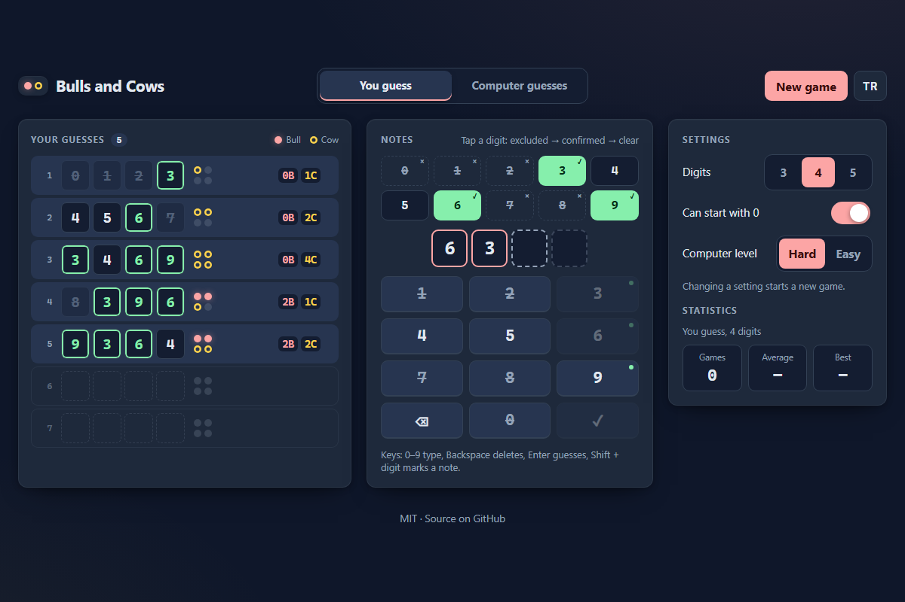

# Bulls and Cows - crack the secret number, or let a minimax solver crack yours

[](#tests)
[](LICENSE)

**▶ Play now: https://celaldrg.github.io/bulls-and-cows/**



Bulls and Cows is the classic pen-and-paper code-breaking game. One player thinks of a secret number whose digits are all different, the other guesses it. Every guess is scored with **bulls** (right digit in the right place) and **cows** (right digit in the wrong place) until the number is cracked.

## Features

- **Two modes.** In *You guess* you crack the computer's secret. In *Computer guesses* the computer cracks yours while you answer with bulls and cows.
- **A strong solver.** On *Hard* it plays minimax: every guess keeps the worst case, the number of secrets still possible, as small as it can. It cracks every 4-digit secret in at most 7 guesses (about 5.4 on average). *Easy* plays any number that fits your answers.
- **Answers are checked.** The solver shows how many numbers are still possible, does not accept scores that cannot happen (such as 3 bulls and 1 cow with 4 digits), and points to the earlier answers that clash when no number fits them all.
- **Notes.** Mark digits as excluded or confirmed; the marks show on the keypad and in your history.
- **Settings.** 3, 4 or 5 digits, with or without a leading zero.
- **Statistics** for each mode and length: games, average guesses and best game, kept in your browser.
- **English and Turkish**, switchable at any time; the choice is remembered.
- Mobile first, fully playable from the keyboard, respects reduced motion. No dependencies, no build step, no tracking.

## How to play

**You guess.** Enter a number with all-different digits and press ✓. Then read the pegs: a filled rose peg is a bull, a yellow ring is a cow. Use the notes strip to keep track of the digits you have ruled out or pinned down.

**Computer guesses.** Think of a secret number with the same rules and keep it to yourself. For each guess, set the bulls and cows with the − / + steppers and press *Answer*. Made a mistake? *Undo* takes your last answer back.

Keyboard:

- *You guess*: `0`-`9` type a digit, `Backspace` or `Delete` removes one, `Esc` clears the entry, `Enter` guesses, `Shift` + digit cycles the note on that digit.
- *Computer guesses*: `B` adds a bull, `C` adds a cow (`I` works too, for the Turkish *inek*); with `Shift` they remove one. `Enter` answers, `Backspace` undoes the last answer.
- On the mode tabs, `←` / `→`, `Home` and `End` switch modes.

Touch:

- Tap the on-screen keypad, ⌫ and ✓. Tap a digit under *Notes* to cycle it through excluded, confirmed and clear.
- In *Computer guesses*, use the − / + steppers, then *Answer*; *Undo* takes the last answer back.

## Run locally

ES modules do not load from `file://`, so serve the folder over `http://`:

```sh
npx serve .
```

Then open the address it prints, for example http://localhost:3000. Add `?demo` to the address for a fixed mid-game position (the one in the screenshot).

## Tests

```sh
node --test
```

Nothing to install (Node 22 or newer). The tests cover scoring and validation, both game modes, the solver (all 5,040 four-digit secrets in at most 7 guesses, average under 5.6; 5.38 measured), contradiction finding, statistics, storage, settings and the translations. GitHub Actions runs them on every push and pull request.

## Project structure

```text
index.html            page markup; every visible string has a data-i18n key
style.css             dark theme, mobile-first layout
src/main.js           wires the page: tabs, settings, statistics, language, win dialog
src/guess-view.js     "You guess": keypad, notes, keyboard
src/solve-view.js     "Computer guesses": steppers, remaining numbers, contradictions
src/view.js           shared tiles, pegs and history board
src/dom.js            small DOM helpers
src/game.js           game state for both modes (pure)
src/solver.js         minimax and easy solvers, contradiction finder (pure)
src/codes.js          codes, scoring and validation (pure)
src/stats.js          statistics (pure)
src/settings.js       saved settings and language
src/storage.js        the only module that touches localStorage
src/i18n.js           English and Turkish strings
src/rng.js            seeded random numbers (mulberry32)
test/                 node:test suites
docs/screenshot.png   the screenshot above
```

## License

[MIT](LICENSE) © 2026 Celalettin Durgaç

## Türkçe

**▶ Hemen oyna: https://celaldrg.github.io/bulls-and-cows/**

Sayı Bulmaca (Bulls and Cows), kâğıt kalemle oynanan klasik şifre kırma oyunudur. Bir oyuncu rakamları birbirinden farklı gizli bir sayı tutar, öbürü bu sayıyı tahmin eder. Her tahmin **boğa** (doğru rakam, doğru yerde) ve **inek** (doğru rakam, yanlış yerde) sayısıyla puanlanır; oyun sayı bulunana kadar sürer.

### Özellikler

- **İki mod.** *Sen bul* modunda bilgisayarın tuttuğu sayıyı sen bulursun. *Bilgisayar bulsun* modunda senin tuttuğun sayıyı bilgisayar bulur, sen de boğa ve inek sayısıyla cevap verirsin.
- **Güçlü çözücü.** *Zor* seviyede minimaks oynar: her tahminde, en kötü durumda kalacak olası sayı adedini olabildiğince küçük tutar. 4 basamaklı her sayıyı en çok 7 tahminde bulur (ortalama 5,4 civarı). *Kolay* seviye, cevaplarına uyan herhangi bir sayıyı dener.
- **Cevap denetimi.** Kalan olası sayı adedini gösterir, olamayacak cevapları (4 basamakta 3 boğa 1 inek gibi) kabul etmez, hiçbir sayı tüm cevaplara uymuyorsa çelişen cevapları gösterir.
- **Notlar.** Rakamları elendi ya da kesin diye işaretle; işaretler tuş takımında ve geçmişte görünür.
- **Ayarlar.** 3, 4 ya da 5 basamak; sayı 0 ile başlayabilir ya da başlayamaz.
- **İstatistikler** her mod ve basamak sayısı için: oyun sayısı, ortalama tahmin ve en iyi oyun; tarayıcında saklanır.
- **İngilizce ve Türkçe**, istediğin an değiştirilebilir; seçimin hatırlanır.
- Önce mobil, klavyeyle tamamen oynanır, azaltılmış hareket ayarına uyar. Bağımlılık, derleme adımı ve izleme yok.

### Nasıl oynanır

**Sen bul.** Rakamları farklı bir sayı gir ve ✓ tuşuna bas. Sonra çivilere bak: dolu pembe çivi boğa, sarı halka inektir. Elediğin ve kesinleşen rakamları notlar şeridinde işaretle.

**Bilgisayar bulsun.** Aynı kurallarla bir sayı tut ve kimseye söyleme. Her tahmin için boğa ve inek sayısını − / + düğmeleriyle ayarla, *Cevapla* düğmesine bas. Yanlış mı girdin? *Geri al* son cevabını geri alır.

Klavye:

- *Sen bul*: `0`-`9` rakam yazar, `Backspace` ya da `Delete` bir rakam siler, `Esc` girişi temizler, `Enter` tahmin eder, `Shift` + rakam o rakamın notunu değiştirir.
- *Bilgisayar bulsun*: `B` boğa, `İ` (ya da `I`, `C`) inek ekler; `Shift` ile birlikte basınca bir azaltır. `Enter` cevaplar, `Backspace` son cevabı geri alır.
- Mod sekmelerinde `←` / `→`, `Home` ve `End` modu değiştirir.

Dokunmatik:

- Ekrandaki tuş takımını, ⌫ ve ✓ tuşlarını kullan. *Notlar* altındaki bir rakama her dokunuşta rakam elendi, kesin ve temiz arasında döner.
- *Bilgisayar bulsun* modunda − / + düğmelerini, ardından *Cevapla* düğmesini kullan; *Geri al* son cevabı geri alır.

### Yerelde çalıştırma

ES modülleri `file://` üzerinden yüklenmez; klasörü `http://` ile sun:

```sh
npx serve .
```

Sonra yazdığı adresi aç, örneğin http://localhost:3000. Sabit bir ara oyun görünümü (ekran görüntüsündeki) için adrese `?demo` ekle.

### Testler

```sh
node --test
```

Kurulum gerekmez (Node 22 ya da üstü). Testler puanlama ve doğrulamayı, iki oyun modunu, çözücüyü (5.040 dört basamaklı sayının hepsi en çok 7 tahminde, ortalama 5,6'nın altında; ölçülen 5,38), çelişki bulmayı, istatistikleri, depolamayı, ayarları ve çevirileri denetler. GitHub Actions bunları her push ve pull request'te çalıştırır.

### Lisans

[MIT](LICENSE) © 2026 Celalettin Durgaç
